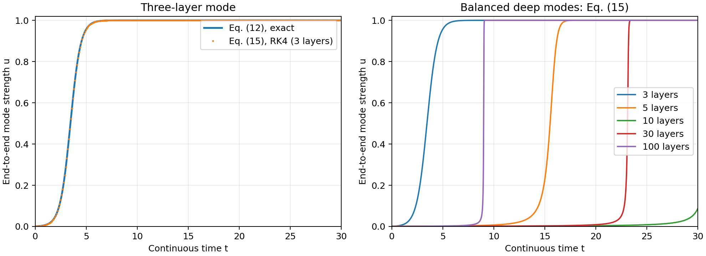
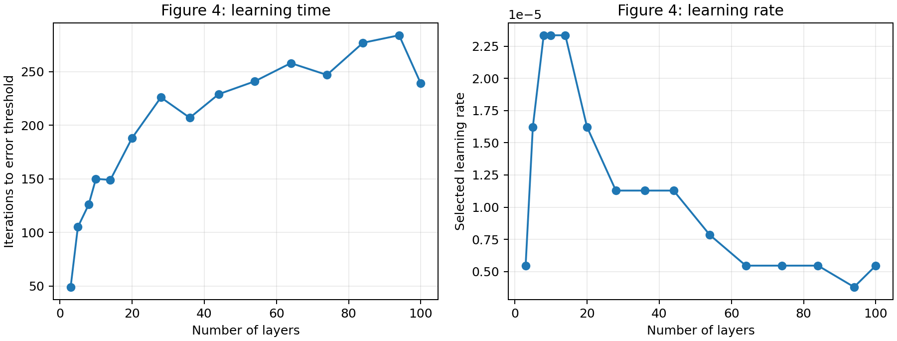

# Saxe et al. (2014)：式 (12)、式 (15) 与图 4 复现

原论文：Andrew M. Saxe, James L. McClelland, Surya Ganguli, *Exact solutions to the nonlinear dynamics of learning in deep linear neural networks*, [arXiv:1312.6120v3](https://arxiv.org/abs/1312.6120).

本项目复现两个模式动力学公式，以及图 4 中“在特定初始化下，学习迭代次数随深度增加后趋于平稳”的趋势。`results/` 中的图均由本项目代码生成，并非原论文图片。

## 当前结果

- **式 (12) 对式 (15)：**当层数为 3、(s=1,u_0=0.001,\tau=1) 时，四阶 Runge–Kutta 数值积分与式 (12) 的解析值最大绝对差为 `1.605e-13`。
- **式 (15)：**绘制 3、5、10、30、100 层在相同连续时间参数下的模式轨迹。这里固定 (\tau)，所以它不等同于图 4 中“每个深度各自优化离散学习率”的实验。
- **图 4：**15 种论文指定深度均在 500 次迭代内越过训练误差门槛。3 层为 49 次，100 层为 239 次；28 至 100 层的结果在 207 至 284 次之间波动，呈现论文讨论的趋缓趋势。数值不要求与原图逐点一致。





全部深度和学习率见 [`results/figure4_summary.csv`](results/figure4_summary.csv)；各候选学习率达到门槛的时间、最佳学习率的采样误差轨迹和运行配置见 [`results/figure4_details.json`](results/figure4_details.json)。

## 方法与论文设置

| 项目 | 本项目采用的设置 |
| --- | --- |
| 数据 | MNIST 训练集前 50,000 个样本；28×28 图像与 10 维独热类别目标 |
| 输入处理 | 像素除以 255；不中心化、不白化。论文未进一步写明图 4 的像素预处理，因此这是明确记录的实现选择 |
| 损失和更新 | (\tfrac12\sum_\mu\lVert y^\mu-\hat y^\mu\rVert^2\)；用论文式 (13) 的批量梯度更新，以预计算的输入相关矩阵和输入输出相关矩阵完成每步 |
| 深度 | 3、5、8、10、14、20、28、36、44、54、64、74、84、94、100 层 |
| 初始化 | 按输入输出相关矩阵的 SVD 对齐权重；每个活跃模式的初始跨层强度 (u_0=0.001) |
| 学习率 | 每个深度分别搜索 (10^{-7}) 至 (10^{-4}) 的 20 个对数均匀候选值；选最早达到门槛者 |
| 学习时间 | 训练误差首次低于 (1.3\times10^4) 的迭代次数；最多运行 500 次 |
| 数值类型 | `float32`；本次结果使用 RTX 3060 Laptop GPU |

论文图 4 使用宽度 1000 的隐藏层。本实现只显式计算其中 **10 个与监督任务相连的活跃通道**，因而可在普通 GPU 上完成全部学习率搜索。对于这里采用的对齐初始化，其余隐藏通道可以构造为正交且与输入输出路径隔离；式 (13) 的梯度不会把它们接入活跃路径。于是活跃通道的更新等价于这一类宽度 1000 的网络。`test_figure4.py` 在一个较小的全宽网络中，用自动微分独立检查了这项约化和单步更新。原论文没有逐项规定全宽权重的具体随机实现，因此本项目应视为**对论文所研究的初始化类别及图 4 趋势的复现**，不是对作者原始运行的逐位复制。

## 运行

建议 Python 3.8 或更新版本。安装依赖后，在此目录执行：

```powershell
python -m pip install -r requirements.txt
python download_data.py
python -m unittest -v test_equations.py test_figure4.py
python equations.py
python figure4.py --device cuda --max-epochs 500
```

没有 CUDA GPU 时，可把最后一行改为 `--device cpu`。数据下载脚本会核对两个原始 MNIST 文件的 MD5；`data/` 已被 Git 忽略，不会把数据集提交到仓库。当前结果在 Python 3.8.5、NumPy 1.24.4、Matplotlib 3.3.2、PyTorch 2.0.0+cu118 下生成。

## 解释边界

图 4 测量的是**达到固定训练误差所需的迭代次数**，不是实际运行时间。作者的解析深度结论依赖特殊初始化和学习率选择；本项目也只检验该条件下的结果。输入预处理、浮点数精度及离散学习率网格都可能使复现曲线与论文原图不同。该实验未测量测试集准确率或泛化能力。
